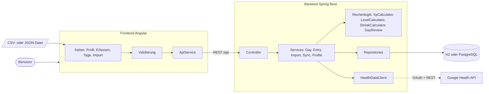
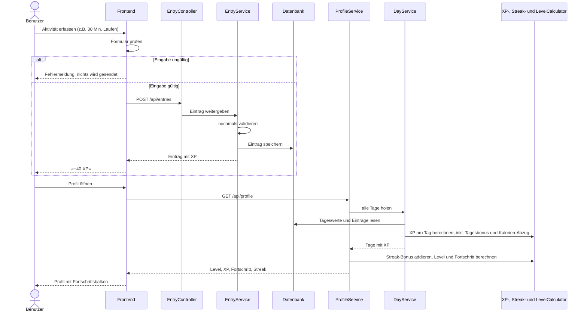
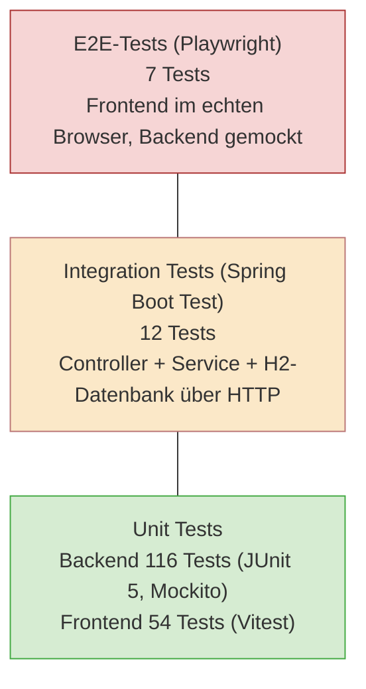
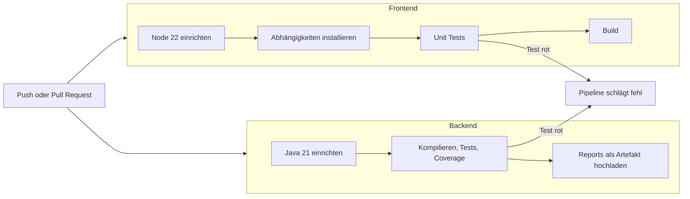

# Health Leveling System

Mein Projekt im Modul 450 «Applikationen testen» an der TBZ.

Ich habe ein Google Fitbit Air Band geschenkt bekommen und wollte die Daten nicht nur in einer App anschauen. Die Idee war, daraus ein kleines Spiel zu machen: Wer gut schläft, sich bewegt und regelmässig Einträge macht, sammelt XP und steigt im Level auf. So wie in einem Rollenspiel, nur mit dem eigenen Alltag.

Im Modul geht es ums Testen und nicht darum, möglichst viele Features zu bauen. Deshalb ist der grösste Teil dieser README dem Testing gewidmet. Die Applikation selbst ist eher das Mittel zum Zweck.

Die ursprüngliche Projektidee mit Planung steht in [BESCHREIBUNG.md](BESCHREIBUNG.md).

## Inhalt

1. [Was die Applikation macht](#was-die-applikation-macht)
2. [Wie die Applikation funktioniert](#wie-die-applikation-funktioniert)
3. [Testing](#testing)
4. [Pipeline](#pipeline)
5. [Applikation starten](#applikation-starten)
6. [KI-Nutzung](#ki-nutzung)
7. [Weitere Dokumente](#weitere-dokumente)

## Was die Applikation macht

Es gibt genau ein Profil, nämlich meins. Das Profil hat ein Level, Gesamt-XP, einen Fortschrittsbalken bis zum nächsten Level und eine Schritte-Serie (Streak). Dazu kommen sechs Achievements, zum Beispiel «7 Tage in Folge 10'000 Schritte» oder «Level 5 erreicht».

Daten kommen auf drei Wegen in die Applikation:

- **Manuell im Frontend:** Aktivitäten, Mahlzeiten, Getränke und Gewicht als einzelne Einträge, ausserdem Schritte und Schlaf-Score pro Tag.
- **Datei-Import:** Eine CSV- oder JSON-Datei mit Tageswerten, zum Beispiel aus dem Google-Export.
- **Google Health API:** Schritte, Schlaf und Trainings werden direkt von Google geholt, auf Knopfdruck oder automatisch alle drei Stunden.

Aus diesen Rohdaten werden die XP berechnet. Ein paar Beispiele: 5 XP pro 1000 Schritte, der halbe Schlaf-Score als XP, 10 XP pro Mahlzeit. Wer am Morgen, am Mittag und am Abend etwas erfasst, bekommt einen Bonus. Wer viel mehr isst als empfohlen, verliert XP. Alle Regeln mit den genauen Zahlen stehen im [Backend-README](health-leveling/backend/README.md).

Das Frontend hat vier Seiten: Profil, Erfassen, Tage (mit einem XP-Diagramm der letzten 14 Tage) und Import.

### Tech-Stack

| Bereich | Technologie |
|---|---|
| Backend | Java 21, Spring Boot 4, Maven |
| Frontend | Angular 21 |
| Datenbank | H2 im Speicher (Standard und Tests), PostgreSQL optional über Docker |
| Tests Backend | JUnit 5, Mockito, AssertJ, Spring Boot Test, MockMvc |
| Tests Frontend | Vitest, Angular TestBed, Playwright |
| Reports | JaCoCo (Coverage), Surefire (Testreport) |
| CI | GitHub Actions |

## Wie die Applikation funktioniert

### Aufbau

Das Frontend spricht nur über einen einzigen Service mit dem Backend. Im Backend ist alles nach Fachbereichen aufgeteilt: Tage, Einträge, Import, Google und Leveling. Die ganze Rechenlogik (XP, Level, Streak, Tagesrückblick) liegt in eigenen kleinen Klassen ohne Datenbankzugriff. Das war eine bewusste Entscheidung, weil sich diese Klassen dadurch sehr einfach testen lassen.

Die Google-Anbindung steckt hinter einem eigenen Interface (HealthDataClient). Der Rest der Applikation weiss nicht, dass dahinter Google steht. In den Tests wird dieses Interface durch einen Mock ersetzt, und falls Google die API irgendwann abstellt, funktioniert die App mit dem Datei-Import weiter.

### Vom Eintrag zum Level

Das Wichtigste am Backend: Das Profil wird **nicht gespeichert**. Gespeichert werden nur die Rohdaten, also Tageswerte und Einträge. Jedes Mal, wenn das Profil abgefragt wird, rechnet das Backend alles neu aus. Am Anfang wollte ich das Profil in der Datenbank speichern, aber dann hätte ich bei jedem gelöschten Eintrag oder doppelten Import aufpassen müssen, dass die XP nicht falsch hängen bleiben. So kann das gar nicht passieren.

Das Diagramm zeigt, was passiert, wenn ich eine Aktivität erfasse und danach das Profil öffne:

Beim Import und bei der Google-Synchronisation ist es ähnlich. Die Werte werden geprüft und als Tag gespeichert. Gibt es den Tag schon, wird er aktualisiert statt doppelt angelegt. Beim nächsten Aufruf des Profils sind die neuen XP automatisch dabei.

## Testing

### Mein Ansatz

Ich habe die Tests nach der Testpyramide aufgebaut. Unten viele schnelle Unit Tests, die einzelne Klassen prüfen. In der Mitte Integration Tests, die das Backend als Ganzes über HTTP mit einer echten Datenbank testen. Oben wenige E2E-Tests, die im Browser durch das Frontend klicken.

Zwei Regeln waren mir dabei wichtig:

1. **Kein Test hängt von etwas Externem ab.** Weder von Google noch von meinen echten Gesundheitsdaten noch davon, ob gerade das Backend läuft. Alles Externe wird gemockt.
2. **Grenzwerte werden immer getestet.** Bei fast jeder Regel gibt es einen Test für genau auf der Grenze, knapp darunter und knapp darüber.

Alles zusammen sind es **189 Tests**: 128 im Backend, 54 Unit Tests und 7 E2E-Tests im Frontend.

### TDD bei der Rechenlogik

Die XP- und Level-Berechnung habe ich mit Test Driven Development geschrieben. Das hat sich angeboten, weil die Regeln schon vorher klar auf Papier standen (zum Beispiel «Level n auf n+1 braucht 100 mal n XP»). Solche Regeln kann man direkt als Test aufschreiben, bevor es überhaupt Code gibt.

Das Vorgehen war jedes Mal gleich:

1. **Red:** Einen Test für eine Regel schreiben, zum Beispiel «bei 300 XP ist man Level 3». Der Test schlägt fehl, weil es die Methode noch nicht gibt.
2. **Green:** Gerade so viel Code schreiben, dass der Test grün wird.
3. **Refactor:** Den Code aufräumen, Konstanten statt fixe Zahlen, doppelte Teile zusammenfassen. Die Tests zeigen dabei sofort, ob ich etwas kaputt gemacht habe.

So sind XpCalculator, LevelCalculator, StreakCalculator und DayReview entstanden. Für diese Klassen habe ich viele parametrisierte Tests verwendet. Statt zehn fast gleiche Testmethoden zu schreiben, gibt es eine Methode mit einer Tabelle aus Eingabe und erwartetem Ergebnis. Für die Schritte sieht diese Tabelle etwa so aus: 0 Schritte gibt 0 XP, 999 gibt 0, 1000 gibt 5, 9999 gibt 45, 10'000 gibt 70 (wegen dem Bonus), 20'000 gibt 120 und 35'000 gibt immer noch 120, weil ab 20'000 nicht mehr gezählt wird.

Ehrlicherweise sieht man die einzelnen Red-Green-Schritte in der Git-Historie nicht, weil ich das Backend in zwei grossen Commits hochgeladen habe. Das würde ich beim nächsten Mal anders machen.

### Unit Tests im Backend

| Testklasse | Was geprüft wird | Tests |
|---|---|---|
| XpCalculatorTest | XP für Schritte, Schlaf, Aktivitäten, Mahlzeiten, Getränke und Gewicht, inklusive Obergrenzen | 30 |
| DayReviewTest | Zuordnung der Uhrzeit zu Morgen, Mittag, Abend, Tagesbonus, Kalorien-Abzug | 16 |
| LevelCalculatorTest | Level aus Gesamt-XP, benötigte XP pro Level, Fortschritt in Prozent, negative XP | 15 |
| StreakCalculatorTest | Bonus an Tag 7, 14, 21, Lücke setzt die Serie zurück, aktuelle und längste Serie | 9 |
| EntryServiceTest | Einträge erfassen, Pflichtfelder pro Typ, Löschen, nicht gefundener Eintrag | 9 |
| ImportServiceTest | CSV und JSON einlesen, leere Zellen, Windows-Zeilenenden, fehlerhafte Dateien | 8 |
| DailyValuesTest | Validierung der Tageswerte, Grenzwerte, Datum in der Zukunft | 7 |
| ProfileServiceTest | Gesamt-XP, XP nie unter 0, Streak-Bonus, Achievements | 7 |
| SyncServiceTest | Synchronisation mit Google, ungültiger Zeitraum, API nicht erreichbar | 6 |
| DayServiceTest | Tage speichern und aktualisieren, Werte und Einträge zu einem Tag zusammenführen | 5 |
| GoogleHealthClientTest | Anfragen an Google und Auswertung der Antworten, Fehler beim Token | 4 |

Ein paar Fälle, die mir beim Schreiben der Tests aufgefallen sind und die ich sonst wahrscheinlich übersehen hätte:

- **0 Schritte ist nicht dasselbe wie keine Daten.** Ein leeres Feld im Import muss leer bleiben und darf nicht zu 0 werden. Dafür gibt es eigene Tests im Import und in der Validierung.
- **Schlaf nach Mitternacht.** Wenn ich um 23 Uhr einschlafe und um 7 Uhr aufwache, gehört der Schlaf zum nächsten Tag. Google liefert die Zeiten in UTC, also muss das in der lokalen Zeitzone umgerechnet werden.
- **Streak am Morgen.** Am Morgen hat man die 10'000 Schritte noch nicht erreicht. Die Serie darf deshalb nicht schon auf 0 fallen, sondern zählt bis gestern.
- **Ein fehlerhafter Import speichert gar nichts.** Wenn in Zeile 5 eine negative Schrittzahl steht, werden auch Zeile 1 bis 4 nicht gespeichert. Die Fehlermeldung nennt die Zeilennummer.

### Mocking

Ich habe an drei Stellen gemockt, je nachdem was ich testen wollte.

**Mockito für Services:** Bei den Service-Tests ersetze ich die Repositories und andere Services durch Mocks. So teste ich nur die Logik des Services und brauche keine Datenbank. Beim SyncService wird zum Beispiel der HealthDataClient gemockt. Ich kann ihm sagen «gib diese zwei Tage zurück» oder «wirf einen Fehler» und dann prüfen, ob der Service richtig reagiert. Ein Test prüft auch, dass die automatische Synchronisation alle drei Stunden nicht abstürzt, wenn Google nicht erreichbar ist.

**Gemockter Server für Google:** Beim GoogleHealthClient wollte ich mehr testen als nur «die Methode wird aufgerufen». Dort läuft ein gemockter HTTP-Server von Spring. Er prüft, ob meine Anfrage die richtige URL, den richtigen Token und das richtige Datum enthält, und antwortet mit JSON-Dateien. Das Format dieser Dateien habe ich vorher mit dem kleinen Tool in [api-explorer](api-explorer/) an der echten API angeschaut. So ist der Test nahe an der Realität, ohne dass er Google wirklich aufruft.

**Gemocktes Backend im Frontend:** In den Unit Tests des Frontends wird entweder der ApiService durch einen Mock ersetzt oder das HTTP mit dem Angular HttpTestingController abgefangen. In den E2E-Tests beantwortet Playwright alle Anfragen an /api direkt im Browser. Für das Frontend gibt es also kein laufendes Backend und keine echten Daten.

### Integration Tests

Die Integration Tests starten die ganze Spring-Boot-Applikation mit der H2-Datenbank und schicken echte HTTP-Anfragen an die Endpunkte. Nach jedem Test wird die Datenbank zurückgesetzt, damit sich die Tests nicht gegenseitig beeinflussen.

Getestet werden ganze Abläufe, zum Beispiel:

- Ein neues Profil startet bei Level 1 mit 0 XP.
- Datei importieren, Einträge erfassen und prüfen, dass das Profil auf das richtige Level steigt. Die erwarteten XP habe ich vorher von Hand ausgerechnet und als Kommentar in den Test geschrieben.
- Dieselbe Datei zweimal importieren erzeugt keine doppelten Tage.
- Einen Eintrag löschen nimmt die XP wieder weg.
- Ungültige Eingaben geben den Statuscode 400 mit einer verständlichen Begründung zurück.
- Ohne Google-Zugangsdaten gibt die Synchronisation 503 zurück, statt abzustürzen.

Zusätzlich gibt es einen Repository-Test, der mit der echten Datenbank prüft, dass die Einträge eines Tages richtig gefiltert und nach Uhrzeit sortiert werden.

### Frontend

Die 54 Unit Tests im Frontend prüfen vor allem drei Dinge:

- **Validierung:** Keine Dezimalzahlen bei Minuten und Schritten, kein Datum in der Zukunft, Wertebereiche wie Schlaf-Score von 0 bis 100. Die Grenzen sind dieselben wie im Backend.
- **Verhalten der Seiten:** Ein ungültiges Formular wird nicht gesendet und die Fehler werden erklärt. Beim Wechsel des Eintragstyps erscheinen nur die passenden Felder. Löschen braucht eine Bestätigung.
- **Fehlermeldungen:** Wenn das Backend nicht erreichbar ist oder einen Fehler zurückgibt, sieht man eine verständliche Meldung statt einer leeren Seite.

Die 7 E2E-Tests mit Playwright gehen die wichtigsten Wege durch: Profil anzeigen, durch alle Seiten navigieren, eine Aktivität erfassen, eine ungültige Eingabe, das XP-Diagramm, einen CSV-Import und was passiert, wenn das Backend ausgefallen ist.

### Coverage und Reports

Bei jedem Build im Backend erstellt JaCoCo einen Coverage-Report und Surefire einen Testreport als HTML.

| | Abdeckung |
|---|---|
| Zeilen | 99.1 % |
| Branches | 95.6 % |

Die Zahl selbst war für mich nicht das Ziel. Ich habe den Report vor allem benutzt, um Stellen zu finden, an die ich beim Testen nicht gedacht hatte.

### Was nicht getestet wird

- Die echte Verbindung zu Google wird in keinem automatischen Test aufgerufen. Das habe ich nur von Hand mit dem api-explorer ausprobiert.
- PostgreSQL wird nicht automatisch getestet. Alle Tests laufen mit H2.
- Das Styling und das Aussehen der Seiten werden nicht getestet.

## Pipeline

Die Pipeline läuft mit GitHub Actions bei jedem Push und jedem Pull Request auf den Branch Project, aber nur wenn sich etwas im Projektordner geändert hat. Backend und Frontend laufen parallel.

Die Reports des Backends werden auch dann hochgeladen, wenn ein Test fehlschlägt. So sieht man direkt in GitHub, welcher Test kaputt ist. Die E2E-Tests laufen im Moment nur lokal, weil dafür in der Pipeline zuerst ein Browser mit allen Systembibliotheken installiert werden müsste.

## Applikation starten

Voraussetzungen sind JDK 21 und Node 22. Docker braucht es nur, wenn man PostgreSQL statt H2 verwenden will.

1. Im Ordner health-leveling/backend das Backend über den Maven Wrapper starten. Es läuft danach auf Port 8080 mit einer H2-Datenbank im Speicher.
2. Im Ordner health-leveling/frontend die Abhängigkeiten mit npm installieren und das Frontend starten. Es läuft auf Port 4200 und leitet alle Anfragen an /api ans Backend weiter.
3. Für die Google-Synchronisation müssen die Umgebungsvariablen GOOGLE_CLIENT_ID, GOOGLE_CLIENT_SECRET und GOOGLE_REFRESH_TOKEN gesetzt sein. Ohne sie funktioniert alles andere trotzdem.

Wie man die Tests einzeln startet und wo die Reports liegen, steht im [Backend-README](health-leveling/backend/README.md) und im [Frontend-README](health-leveling/frontend/README.md).

## KI-Nutzung

Im Projekt ist KI erlaubt, wenn sie deklariert wird. Ich habe sie für folgendes verwendet:

- **Als Nachschlagewerk und bei Fehlern:** Wenn ich nicht weiterkam, habe ich gefragt, woran es liegt, und versucht zu verstehen, warum.
- **Research:** Welche Libraries und Tools sich für das Projekt eignen und wie man sie einsetzt.
- **Google Health API:** Ich habe die API zum ersten Mal benutzt. Für die Anmeldung über OAuth und das Format der Anfragen habe ich mir von der KI helfen lassen.
- **Styling im Frontend:** Komponenten und HTML habe ich selbst geschrieben, das Styling hat grösstenteils die KI gemacht.
- **Kontrolle der Pull Requests:** Vor dem Mergen habe ich Claude Code über meine Änderungen schauen lassen. Die eigentlichen Code Reviews macht aber eine Person.
- **Grammatik Korrektur:** Dieses Readme habe ich geschrieben doch dazu wurde mithilfe von KI die Grammatik und Logik verbessert.

## Weitere Dokumente

| Dokument | Inhalt |
|---|---|
| [BESCHREIBUNG.md](BESCHREIBUNG.md) | Ursprüngliche Projektidee und Planung |
| [Backend-README](health-leveling/backend/README.md) | Endpunkte, alle XP-Regeln, Achievements, Importformat |
| [Frontend-README](health-leveling/frontend/README.md) | Seiten, Aufbau, Validierungsregeln |
| [IMPORT_FORMAT.md](IMPORT_FORMAT.md) | Aufbau der Google-Exportdateien |
| [ENDPOINTS.md](ENDPOINTS.md) | Endpunkte der Google Health API |
| [OFFENE-PUNKTE.md](OFFENE-PUNKTE.md) | Was bis zur Abgabe noch fehlt |

## Autor

Felipe Pereira, TBZ
